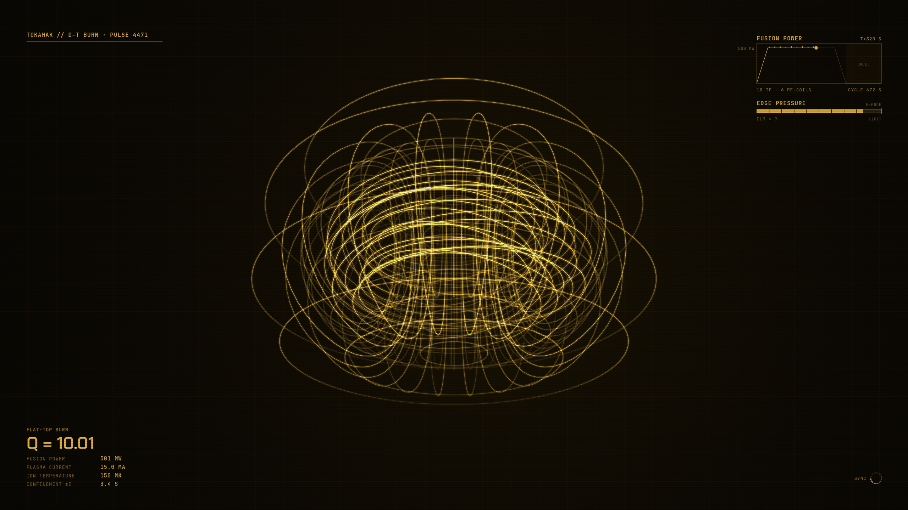

# Holoframe · Tokamak Reactor

An [Omarchy](https://omarchy.org) theme with an animated wireframe-hologram background in amber.



A fusion reactor drawn with 18 D-shaped field coils, 6 ring coils and a central solenoid around a plasma of field lines winding the torus. Every 42 seconds it runs one full machine cycle: ramp-up, burn, ramp-down, then a dwell with no plasma while the solenoid recharges, counting down to the next pulse. The plasma field lines fade in and out with the plasma current. During the burn, edge-localized modes (ELMs) build and release edge pressure on a gauge under the power chart, spike the power trace and briefly lift Q. The figures are modelled on ITER (500 MW, Q = 10, 15 MA, 150 million K). The ring is centred so the lock screen's password field sits inside it.

Holoframe is a set of five themes, each a single-hue hologram on near-black with bracketed HUD panels, live readouts and scanlines. Every scene is based on real engineering or physics, and all artwork is original and drawn in code.

## Install

```bash
omarchy theme install https://github.com/toasty-sunbeam/omarchy-holoframe-tokamak-theme.git
```

## What's included

| File | Purpose |
|---|---|
| `backgrounds/1-tokamak-loop.mp4` | Seamless 42-second animated background (2560×1600, H.264): one full pulse and dwell. The default. |
| `backgrounds/2-tokamak-still.png` | Still version (3072×1920). Switch with `omarchy theme bg next`. |
| `colors.toml` | Palette, plus a gradient window border that fades from the accent to a dim edge. |
| `shell.lock.toml` | Lock screen password field: a translucent card with thick side edges that light up while you type. |
| `icons.theme` | Matching Yaru icon colour. |

Omarchy generates terminal, editor and app colours from `colors.toml`.

## Pausing the animation

Video backgrounds are played by Omarchy's wallpaper daemon, OWE, which already pauses during fullscreen apps. To pause or resume by hand:

```bash
owe pause
owe resume
```

To toggle it with Super+Alt+P, add this to `~/.config/hypr/bindings.lua`:

```lua
o.bind("SUPER + ALT + P", "Pause background animation",
  [[sh -c 'if owe status | jq -e .manual_pause >/dev/null; then owe resume; else owe pause; fi']])
```

## Notes

- The HUD is sized for a 2× display at a 16:10 aspect ratio (rendered for a 3072×1920 panel). It works on other screens, with the HUD text slightly larger or smaller.
- The lock screen shows the current background frozen, with Omarchy's own password field at the centre. Each scene keeps its centre calm for that reason.
- The look is inspired by the holographic loading screens of Mass Effect 2. This project is not affiliated with or endorsed by BioWare or Electronic Arts, and contains no assets from the game.

## Other Holoframe variants

- [Orbital Watch](https://github.com/toasty-sunbeam/omarchy-holoframe-orbital-theme) (green)
- [Dyson Swarm](https://github.com/toasty-sunbeam/omarchy-holoframe-dyson-theme) (orange)
- [O'Neill Habitat](https://github.com/toasty-sunbeam/omarchy-holoframe-oneill-theme) (magenta)
- [Cycler Navigation](https://github.com/toasty-sunbeam/omarchy-holoframe-cycler-theme) (blue)

## License

[MIT](LICENSE)
